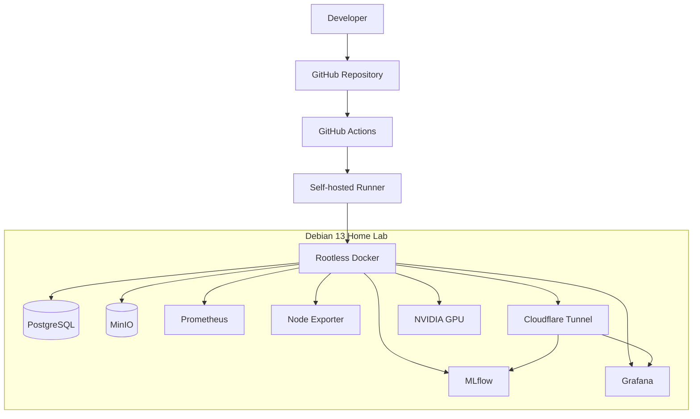

# Home Lab — MLOps Infrastructure

A self-hosted infrastructure project designed to support machine learning development, experiment tracking, artifact storage, CI/CD automation, GPU workloads, and infrastructure monitoring.

The project runs on a Debian 13 home server using Docker Compose and rootless Docker. External access is provided through Cloudflare Tunnel, while GitHub Actions automates infrastructure deployment.

This repository is a public showcase of the work completed so far. The operational repository used for deployment remains private and is the source of truth for the live homelab. Its self-hosted runner is attached to that private repository; this public showcase has no active runner. GitHub recommends using self-hosted runners only with private repositories because pull requests from public forks can run untrusted code on the runner ([GitHub Actions runner security guidance](https://docs.github.com/en/actions/how-tos/manage-runners/self-hosted-runners/add-runners)).

## Architecture



### Main components

| Component | Purpose |
|---|---|
| Debian 13 | Host operating system |
| Docker Compose | Container orchestration |
| Rootless Docker | Unprivileged container runtime |
| GitHub Actions | CI/CD automation |
| MLflow | Experiment tracking and model artifact management |
| PostgreSQL | MLflow backend database |
| MinIO | S3-compatible artifact storage |
| Prometheus | Metrics collection and storage |
| Node Exporter | Host-level metrics exporter |
| Grafana | Monitoring dashboards and visualization |
| Cloudflare Tunnel | Secure external access |
| Cloudflare Access | Authentication and access control |
| NVIDIA Container Toolkit | GPU passthrough to containers |

## Hardware

The infrastructure runs on:

- **Operating system:** Debian 13 (Trixie)
- **CPU:** Intel Core i5, 10th generation
- **Memory:** 16 GB RAM
- **GPU:** NVIDIA GeForce RTX 2060
- **Container runtime:** Docker Engine with rootless mode for the deployment user

The hardware is intended for experimentation and small-to-medium machine learning workloads rather than production-scale model training.

## Repository structure

```text
home-lab/
├── .github/
│   └── workflows/
│       └── deploy.yaml
├── docs/
│   ├── cadvisor/
│   │   └── README.md
│   ├── cloudflare/
│   │   └── README.md
│   ├── grafana/
│   │   └── README.md
│   ├── mlflow/
│   │   └── README.md
│   ├── prometheus/
│   │   └── README.md
│   └── runner/
│       └── README.md
├── Dockerfile
├── docker-compose.yaml
├── prometheus/
│   └── prometheus.yaml
├── grafana/
│   └── datasources/
│       └── datasources.yaml
├── .env.example
├── .gitignore
└── README.md
```

The exact directory structure may evolve as additional services are introduced.

## MLOps infrastructure

### MLflow

MLflow provides experiment tracking and artifact management.

The tracking server uses PostgreSQL as its backend store and MinIO as its artifact storage backend.

- Tracking server: port `5000`
- Backend store: PostgreSQL
- Artifact storage: MinIO
- Artifact access: MLflow artifact serving
- External access: Cloudflare Tunnel

The MLflow server is configured with:

```text
--backend-store-uri <POSTGRESQL_CONNECTION_URI>
--artifacts-destination s3://mlflow-artifacts
--serve-artifacts
```

The S3-compatible endpoint is provided through MinIO.

### PostgreSQL

PostgreSQL stores MLflow metadata, including:

- Experiments
- Runs
- Parameters
- Metrics
- Artifact metadata

Data is persisted using a Docker named volume.

### MinIO

MinIO provides S3-compatible object storage for MLflow artifacts.

The deployment includes an initialization service that waits for MinIO to become available and creates the `mlflow-artifacts` bucket.

Persistent storage is provided through a Docker named volume.

## Monitoring infrastructure

Prometheus collects metrics from the host and monitoring targets.

Node Exporter exposes host-level metrics, including CPU, memory, filesystem and network statistics.

Grafana provides dashboards for visualizing the collected metrics.

See:

- [Grafana documentation](docs/grafana/README.md)
- [Prometheus and Node Exporter documentation](docs/prometheus/README.md)
- [cAdvisor documentation](docs/cadvisor/README.md)

## CI/CD pipeline

GitHub Actions automates infrastructure deployment.

The deployment workflow performs the following steps:

1. Checks out the repository.
2. Copies the deployment `.env` file from a protected directory on the server.
3. Validates the Docker Compose configuration.
4. Builds the required images.
5. Deploys the containers.
6. Waits for MLflow's health endpoint.
7. Displays container status and logs.

The self-hosted runner executes under a dedicated Linux account named `runner`.

### Deployment environment

The deployment `.env` file is stored outside the operational repository:

```text
/home/runner/secrets/.env
```

The private deployment workflow copies it into the workspace before running Docker Compose. The paths and hostnames in this public showcase are examples; configure them for your own environment.

**Never commit `.env` or production credentials to Git.**

See [Self-hosted Runner and Rootless Docker](docs/runner/README.md).

## Container security

The project uses rootless Docker for the GitHub Actions deployment environment.

Security measures include:

- A dedicated Linux account for the GitHub Actions runner.
- No sudo privileges for the runner account.
- No membership in the Docker group.
- Rootless Docker running under the dedicated account.
- Private storage for deployment environment variables.
- Cloudflare Tunnel instead of directly exposing application services.
- Cloudflare Access for authenticated external access.
- Persistent volumes for application data.
- Restricted access to infrastructure management interfaces.

Rootless Docker reduces the privileges of the container daemon and its containers. It does not eliminate all risks associated with executing untrusted code.

**Important:** Never execute untrusted pull requests or arbitrary public-repository workflows on the persistent self-hosted runner. Public repository CI should use GitHub-hosted runners. Keep deployment workflows and runner access restricted.

## External access

Cloudflare Tunnel provides external access without requiring direct inbound port forwarding on the home network.

Intended hostnames:

| Service | Hostname |
|---|---|
| MLflow | `mlflow.example.com` |
| Grafana | `grafana.example.com` |

Cloudflare Tunnel routes requests to the corresponding Docker services through the internal Docker network.

Cloudflare Access provides an additional authentication layer.

PostgreSQL and MinIO administrative interfaces are not published by Compose. Prometheus and
Node Exporter are currently published on all host interfaces by `docker-compose.yaml`; restrict
those ports with the host firewall or change the bindings if they should remain local.

## Deployment

### Requirements

- Debian 13 or a compatible Linux distribution.
- Docker Engine and Docker Compose.
- A configured rootless Docker environment.
- A GitHub Actions self-hosted runner, if using automated deployment.
- NVIDIA drivers and NVIDIA Container Toolkit for GPU workloads.
- A Cloudflare account and configured Tunnel for external access.

### Environment configuration

Create a local `.env` file based on the example:

```bash
cp .env.example .env
```

Configure the required variables, including:

```dotenv
POSTGRES_USER=
POSTGRES_PASSWORD=
POSTGRES_DB=

MINIO_ROOT_USER=
MINIO_ROOT_PASSWORD=

GRAFANA_ADMIN_USER=
GRAFANA_ADMIN_PASSWORD=

CADVISOR_DOCKER_SOCKET=/path/to/rootless/docker.sock
CADVISOR_DOCKER_ROOT=/path/to/rootless/docker-data
```

Set both cAdvisor paths to the rootless Docker socket and data directory on your host. The socket grants access to the Docker API, so keep the actual paths in the local `.env` file and do not expose the socket. Use strong, unique credentials; do not use example values as production credentials.

### Validate and deploy

From the repository directory:

```bash
docker compose config --quiet
docker compose build
docker compose up -d --remove-orphans
docker compose ps
```

Inspect service logs:

```bash
docker compose logs -f
```

For individual services:

```bash
docker compose logs -f mlflow
docker compose logs -f grafana
docker compose logs -f prometheus
```

The GitHub Actions workflow performs the deployment automatically when its configured trigger conditions are met.

## Persistence and backups

Named Docker volumes preserve application data across container recreation.

Important persistent data includes:

- `postgres_data`
- `minio_data`
- `prometheus_data`
- `grafana_data`

Removing or recreating a container does not normally remove its named volume.

However, Docker volumes are not backups. Implement regular backups of PostgreSQL, MinIO and Grafana data, and periodically test restoration.

Never use `docker compose down -v` unless you intentionally want to remove the associated volumes and their data.

## Limitations and future improvements

Potential improvements include:

- Automated database and artifact backups.
- Backup restoration testing.
- Prometheus alerting with Alertmanager.
- Grafana dashboard provisioning.
- MLflow model registry workflows.
- Model training pipelines using the NVIDIA GPU.
- Automated deployment health checks for all services.
- Container image vulnerability scanning.
- Infrastructure-as-code improvements.
- Separate development and production environments.

## Documentation

| Document | Description |
|---|---|
| [cAdvisor](docs/cadvisor/README.md) | Container-level metrics and Docker integration |
| [Cloudflare](docs/cloudflare/README.md) | Tunnel and Access configuration notes |
| [Grafana](docs/grafana/README.md) | Configuration, dashboards and troubleshooting |
| [MLflow](docs/mlflow/README.md) | Tracking server, PostgreSQL and MinIO integration |
| [Prometheus and Node Exporter](docs/prometheus/README.md) | Metrics collection and host monitoring |
| [Runner and Rootless Docker](docs/runner/README.md) | Linux user isolation, runner installation and GPU access |

---

This repository documents a personal home-lab infrastructure project. Configuration examples are provided for educational and reproducibility purposes. Production deployments require environment-specific security, backup and operational considerations.
