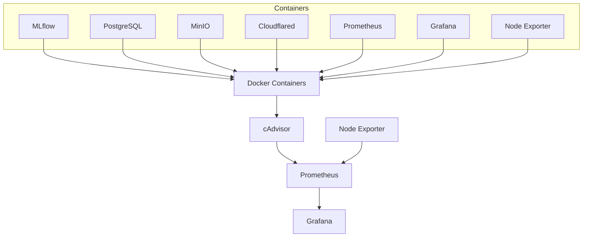

# cAdvisor — Container Monitoring

## Overview

[cAdvisor (Container Advisor)](https://github.com/google/cadvisor) is an open-source tool that collects resource usage and performance metrics from running containers.

It provides container-level observability, complementing Node Exporter, which focuses primarily on host-level metrics.

In this home lab, cAdvisor exposes metrics to Prometheus, which stores them and makes them available for visualization through Grafana.

## Architecture



### Monitoring responsibilities

| Component | Responsibility |
|---|---|
| cAdvisor | Container-level resource metrics |
| Node Exporter | Linux host metrics |
| Prometheus | Metrics collection and storage |
| Grafana | Metrics visualization and dashboards |

## Deployment

### Docker environment

This home lab uses rootless Docker, running under the dedicated `runner` Linux user.

Unlike conventional rootful Docker installations, the Docker socket and container storage are located in the user's runtime and home directories.

| Resource | Location |
|---|---|
| Docker socket | Set locally as `CADVISOR_DOCKER_SOCKET` |
| Docker data directory | Set locally as `CADVISOR_DOCKER_ROOT` |
| cAdvisor metrics endpoint | `http://cadvisor:8080/metrics` |
| cAdvisor web interface | `http://cadvisor:8080` |

### Docker Compose configuration

The cAdvisor service uses the rootless Docker socket to discover containers.

```yaml
cadvisor:
  image: gcr.io/cadvisor/cadvisor:v0.55.1
  container_name: cadvisor
  restart: unless-stopped
  ports:
    - "127.0.0.1:8080:8080"

  volumes:
    - /:/rootfs:ro
    - /sys:/sys:ro
    - /dev/disk:/dev/disk:ro
    - ${CADVISOR_DOCKER_SOCKET:?Set in .env}:/var/run/docker.sock
    - ${CADVISOR_DOCKER_ROOT:?Set in .env}:${CADVISOR_DOCKER_ROOT}:ro
  command:
    - --docker=unix:///var/run/docker.sock
  networks:
    - monitoring
```

**Important:** This configuration provides Docker API access through the rootless socket. The
socket mount is not read-only, and a read-only host filesystem mount does not make Docker API
operations read-only. Treat the socket as a sensitive control interface: anyone or any container
that can use it may control the rootless Docker daemon. Keep the host socket path out of committed
configuration, set it only in the local `.env`, restrict access to that file, keep cAdvisor trusted,
and do not expose its interface publicly. The public `.env.example` intentionally leaves both
cAdvisor host paths blank.

cAdvisor may also require additional permissions or cgroup visibility to collect all resource metrics in a rootless environment. Successful Docker discovery does not guarantee that every metric is available.

## Prometheus integration

Prometheus must scrape cAdvisor to collect container metrics.

The job is already present in [`prometheus/prometheus.yaml`](../../prometheus/prometheus.yaml):

```yaml
- job_name: 'cadvisor'
    scrape_interval: 5s
    static_configs:
        - targets: ['cadvisor:8080']
```

The `cadvisor` hostname is resolved through the shared `monitoring` Docker network.

After updating the configuration, reload Prometheus:

```bash
curl -X POST http://localhost:9090/-/reload
```

Verify the target at:

```text
http://localhost:9090/targets
```

The cAdvisor target should report `UP`.

## Available metrics

Some useful metrics exposed by cAdvisor include:

| Metric | Description |
|---|---|
| `container_cpu_usage_seconds_total` | Cumulative CPU time consumed |
| `container_memory_usage_bytes` | Container memory usage |
| `container_memory_working_set_bytes` | Memory actively used by the container |
| `container_network_receive_bytes_total` | Total received network traffic |
| `container_network_transmit_bytes_total` | Total transmitted network traffic |
| `container_fs_usage_bytes` | Container filesystem usage |
| `container_last_seen` | Last time a container was observed |

Actual availability depends on the Docker runtime, kernel, cgroup configuration and permissions.

## Useful PromQL queries

### CPU usage by container

```promql
sum by (name) (
  rate(container_cpu_usage_seconds_total[5m])
)
```

### Memory usage by container

```promql
container_memory_working_set_bytes
```

### Network received per second

```promql
rate(container_network_receive_bytes_total[5m])
```

### Network transmitted per second

```promql
rate(container_network_transmit_bytes_total[5m])
```

### Filesystem usage

```promql
container_fs_usage_bytes
```

These queries can be used to build Grafana dashboards for identifying resource-intensive containers and investigating performance issues.

## Security considerations

- cAdvisor is only exposed on `127.0.0.1:8080`.
- It is connected to the `monitoring` network, not the application network.
- The rootless Docker socket is mounted for container discovery.
- The Docker socket provides powerful access to the rootless daemon and must be treated as a sensitive resource.
- Host filesystem mounts are read-only.
- The service does not require `privileged: true` in the current configuration.
- The rootful Docker daemon is separate and is not automatically monitored by this cAdvisor instance.

## Troubleshooting

### Docker factory registration fails

Example:

```text
Registration of the docker container factory failed:
permission denied while trying to connect to the Docker daemon socket
```

Check the locally configured Docker socket path:

```bash
stat -c '%A %u:%g %n' "$CADVISOR_DOCKER_SOCKET"
```

Check the active Docker context:

```bash
docker context inspect rootless \
  --format '{{.Endpoints.docker.Host}}'
```

Check cAdvisor logs:

```bash
docker logs --tail=100 cadvisor
```

### Metrics endpoint

```bash
curl http://localhost:8080/metrics
```

Check for container metrics:

```bash
curl -s http://localhost:8080/metrics \
  | grep -E 'container_(cpu_usage_seconds_total|memory_usage_bytes|network_receive_bytes_total)' \
  | head -20
```

### Container health

```bash
docker compose ps cadvisor
```

## Future improvements

- Configure alerts for high container CPU and memory usage.
- Monitor filesystem consumption and network traffic.
- Verify that every application container is discovered.
- Investigate rootless Docker cgroup visibility limitations.
- Evaluate GPU monitoring for machine learning workloads.
- Document the distinction between rootless and rootful Docker monitoring.
