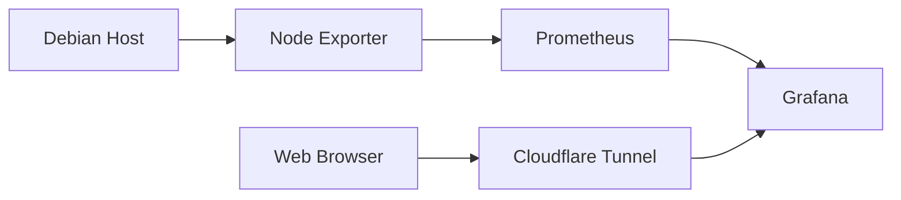

# Grafana — Monitoring and Visualization

Grafana is the visualization layer of the home-lab monitoring infrastructure.

It connects to Prometheus as a metrics data source and provides dashboards for monitoring the Debian host and infrastructure services.

## Architecture



## Technologies

- Grafana
- Prometheus
- Docker Compose
- Docker named volumes
- Cloudflare Tunnel
- Cloudflare Access

## Docker Compose configuration

Example service configuration:

```yaml
grafana:
  image: grafana/grafana:latest
  container_name: grafana
  restart: unless-stopped
  ports:
    - "127.0.0.1:3000:3000"
  volumes:
    - grafana_data:/var/lib/grafana
  environment:
    GF_SECURITY_ADMIN_USER: ${GRAFANA_ADMIN_USER}
    GF_SECURITY_ADMIN_PASSWORD: ${GRAFANA_ADMIN_PASSWORD}
    GF_SERVER_DOMAIN: grafana.example.com
    GF_SERVER_ROOT_URL: https://grafana.example.com/
    GF_SERVER_SERVE_FROM_SUB_PATH: "false"
  networks:
    - monitoring
    - home-lab-network
```

The service joins both networks:

- `monitoring`: communication with Prometheus.
- `home-lab-network`: communication with Cloudflare Tunnel.

The localhost port binding allows local administration without exposing the Grafana port on every host interface.

Adjust the port mapping if your deployment uses a different access method.

## Environment variables

Configure these values in the deployment `.env` file:

```dotenv
GRAFANA_ADMIN_USER=admin
GRAFANA_ADMIN_PASSWORD=replace-with-a-strong-password
```

Do not commit real credentials.

### Important: persistent administrator credentials

Grafana initializes the administrator account using the environment variables when its database is initialized for the first time.

Once the Grafana database exists in the `grafana_data` volume, changing `GRAFANA_ADMIN_PASSWORD` does not automatically reset the existing password.

To reset it to the value currently supplied to the container:

```bash
docker compose exec -T grafana sh -c \
  'grafana cli admin reset-admin-password "$GF_SECURITY_ADMIN_PASSWORD"'
```

This updates the existing administrator password without deleting Grafana's database.

Do not delete `grafana_data` to change credentials. Doing so can remove dashboards, users and other stored configuration.

## Persistence

Grafana stores its database, dashboards and other application data in:

```text
/var/lib/grafana
```

The Compose named volume:

```yaml
volumes:
  grafana_data:
```

persists this data when containers are recreated.

Back up the volume or use an appropriate Grafana backup procedure before making destructive changes.

## Cloudflare Tunnel integration

Grafana is exposed through Cloudflare Tunnel using the hostname:

```text
grafana.example.com
```

Configure the Cloudflare Tunnel public hostname:

| Setting | Value |
|---|---|
| Hostname | `grafana.example.com` |
| Service type | HTTP |
| Service URL | `grafana:3000` |

The `cloudflared` container must share a Docker network with Grafana. In this deployment, both use `home-lab-network`.

Cloudflare Access should protect the hostname and restrict access to authorized users.

### Why `serve_from_sub_path` is false

This deployment uses a subdomain:

```text
https://grafana.example.com/
```

It does not use a URL subpath such as:

```text
https://example.com/grafana/
```

Therefore:

```yaml
GF_SERVER_ROOT_URL: https://grafana.example.com/
GF_SERVER_SERVE_FROM_SUB_PATH: "false"
```

`serve_from_sub_path` should only be enabled when Grafana is actually served from a URL subpath.

## Connecting Prometheus

In Grafana, configure Prometheus as a data source.

Use the internal Docker service name rather than `localhost`:

```text
http://prometheus:9090
```

The URL works because Grafana and Prometheus share the `monitoring` Docker network.

The repository also contains
[`grafana/datasources/datasources.yaml`](../../grafana/datasources/datasources.yaml),
but the current Compose service does not mount that file. The data source therefore
must be configured in Grafana unless the Compose service is intentionally updated to
enable file provisioning.

After configuring the data source, use Grafana dashboards to explore the metrics collected by Prometheus.

## Useful commands

Check Grafana status:

```bash
docker compose ps grafana
```

View logs:

```bash
docker compose logs -f grafana
```

Check the local HTTP endpoint:

```bash
curl -I \
  -H "Host: grafana.example.com" \
  http://localhost:3000/
```

A `302 Found` redirect to `/login` is normal when accessing Grafana without an authenticated session.

Check the login page:

```bash
curl -sL \
  -H "Host: grafana.example.com" \
  http://localhost:3000/login
```

Check whether frontend assets are accessible locally:

```bash
curl -I \
  -H "Host: grafana.example.com" \
  http://localhost:3000/public/build/
```

For an actual asset, use its filename from the login page HTML.

## Troubleshooting

### Grafana says it failed to load application files

Possible causes include:

- Reverse proxy URL configuration.
- Incorrect `root_url`.
- Incorrect subpath configuration.
- JavaScript or CSS requests being blocked.
- Cloudflare Access redirecting frontend asset requests.
- Browser cache or stale frontend assets.

First, test Grafana locally:

```bash
curl -I -H "Host: grafana.example.com" \
  http://localhost:3000/
```

Then test an actual JavaScript asset:

```bash
curl -sS -D - -o /dev/null \
  https://grafana.example.com/public/build/<asset-name>.js
```

If Cloudflare returns a `302` redirect to:

```text
cloudflareaccess.com/cdn-cgi/access/login/
```

Cloudflare Access is intercepting the request. Verify that authentication is working and that the Access application and its policies allow the intended user to access Grafana and its frontend resources.

Also inspect the browser's Developer Tools:

1. Open the Network tab.
2. Reload Grafana.
3. Filter for JS and CSS.
4. Inspect failed requests and their HTTP status codes.

### Grafana accepts the default password

Changing `.env` alone does not update an already initialized Grafana database. Use the administrator password reset command described above.

### Grafana is inaccessible through Cloudflare

Verify:

- The Tunnel is running.
- The public hostname points to `http://grafana:3000`.
- `cloudflared` and Grafana share a Docker network.
- The Grafana container is healthy and listening on port 3000.
- Cloudflare Access policies permit your account.

## Security recommendations

- Use a strong, unique administrator password.
- Protect the hostname with Cloudflare Access.
- Avoid exposing port 3000 publicly.
- Keep Grafana updated.
- Back up `grafana_data`.
- Avoid storing secrets in dashboard definitions or screenshots.
- Do not publish authentication cookies or Access tokens in troubleshooting logs.

## References

- [Grafana documentation](https://grafana.com/docs/grafana/latest/)
- [Grafana configuration](https://grafana.com/docs/grafana/latest/setup-grafana/configure-grafana/)
- [Grafana Docker image](https://hub.docker.com/r/grafana/grafana)
- [Cloudflare Tunnel documentation](https://developers.cloudflare.com/cloudflare-one/connections/connect-networks/)