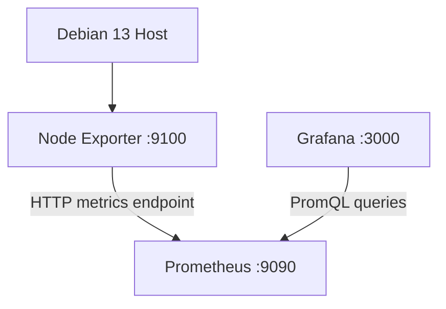

# Prometheus and Node Exporter — Infrastructure Monitoring

This component provides infrastructure metrics collection for the home lab.

Prometheus periodically scrapes metrics exposed by Node Exporter and stores the collected time-series data. Grafana queries Prometheus to visualize the metrics.

## Architecture



## Technologies

- Prometheus
- Node Exporter
- Docker Compose
- Docker named volumes
- Grafana

## Components

### Prometheus

Prometheus is responsible for:

- Scraping metrics from configured targets.
- Storing time-series data.
- Evaluating PromQL queries.
- Providing metrics to Grafana.

Default HTTP port:

```text
9090
```

### Node Exporter

Node Exporter exposes operating-system and hardware metrics from the Linux host.

Examples include:

- CPU utilization and system load.
- Memory usage.
- Filesystem capacity and usage.
- Network interface statistics.
- Disk-related statistics.

Default HTTP metrics port:

```text
9100
```

Node Exporter exposes metrics at:

```text
http://node-exporter:9100/metrics
```

The hostname is resolved through the Docker network.

## Docker Compose configuration

### Prometheus

Example service configuration:

```yaml
prometheus:
  image: prom/prometheus:latest
  container_name: prometheus
  restart: unless-stopped
  volumes:
    - ./prometheus/prometheus.yaml:/etc/prometheus/prometheus.yaml:ro
    - prometheus_data:/prometheus
  command:
    - --config.file=/etc/prometheus/prometheus.yaml
    - --storage.tsdb.path=/prometheus
    - --web.enable-lifecycle
  ports:
    - "9090:9090"
  networks:
    - monitoring
```

### Node Exporter

Example service configuration:

```yaml
node-exporter:
  image: prom/node-exporter:latest
  container_name: node-exporter
  restart: unless-stopped
  volumes:
    - /proc:/host/proc:ro
    - /sys:/host/sys:ro
    - /:/rootfs:ro
  command:
    - --path.procfs=/host/proc
    - --path.rootfs=/rootfs
    - --path.sysfs=/host/sys
    - --collector.filesystem.mount-points-exclude=^/(sys|proc|dev|host|etc)($$|/)
  ports:
    - "9100:9100"
  networks:
    - monitoring
```

The host filesystem mounts are read-only to allow Node Exporter to collect host-level information.

The current Compose bindings publish both ports on all host interfaces. Prometheus still
scrapes Node Exporter over the internal Docker network; restrict the published ports with
the host firewall or bind them to localhost if external access is not required.

### Docker network

Both services use the same network:

```yaml
networks:
  monitoring:
    driver: bridge
```

Grafana also joins this network so it can query Prometheus using:

```text
http://prometheus:9090
```

## Prometheus configuration

The configuration is stored in:

```text
prometheus/prometheus.yaml
```

A minimal example:

```yaml
global:
  scrape_interval: 15s
  evaluation_interval: 15s

scrape_configs:
  - job_name: prometheus
    static_configs:
      - targets:
          - prometheus:9090

  - job_name: node-exporter
    static_configs:
      - targets:
          - node-exporter:9100
```

The scrape targets use Docker service names because Prometheus and Node Exporter communicate over the `monitoring` network.

## Useful PromQL queries

### CPU utilization

Approximate total CPU utilization across the host:

```promql
100 * (1 - avg(rate(node_cpu_seconds_total{mode="idle"}[5m])))
```

### Memory utilization

```promql
100 * (
  1 -
  node_memory_MemAvailable_bytes /
  node_memory_MemTotal_bytes
)
```

### Filesystem utilization

```promql
100 * (
  1 -
  node_filesystem_avail_bytes{fstype!~"tmpfs|overlay"}
  /
  node_filesystem_size_bytes{fstype!~"tmpfs|overlay"}
)
```

### Network received bytes per second

```promql
rate(node_network_receive_bytes_total[5m])
```

### Network transmitted bytes per second

```promql
rate(node_network_transmit_bytes_total[5m])
```

These queries can be used in Grafana panels. Adjust filesystem filters to match the host's actual mounted filesystems.

## Persistence

Prometheus stores its time-series database under:

```text
/prometheus
```

The Docker named volume:

```yaml
volumes:
  prometheus_data:
```

persists collected metrics when the container is recreated.

Prometheus retention and disk usage should be monitored, especially on a host with limited storage.

## Accessing Prometheus

The local Prometheus interface is available at:

```text
http://localhost:9090
```

The targets page is:

```text
http://localhost:9090/targets
```

Use the targets page to verify that Prometheus successfully scrapes its configured exporters.

Node Exporter's metrics can also be checked locally:

```bash
curl http://localhost:9100/metrics
```

## Useful commands

Check services:

```bash
docker compose ps prometheus node-exporter
```

Inspect logs:

```bash
docker compose logs -f prometheus
docker compose logs -f node-exporter
```

Validate the Prometheus configuration:

```bash
docker compose exec prometheus \
  promtool check config /etc/prometheus/prometheus.yaml
```

Reload Prometheus configuration:

```bash
curl -X POST http://localhost:9090/-/reload
```

This requires the lifecycle endpoint to be enabled with:

```text
--web.enable-lifecycle
```

## Troubleshooting

### Prometheus target is DOWN

1. Open the Prometheus targets page.
2. Inspect the target's error message.
3. Confirm that the Node Exporter container is running.
4. Confirm that both services share the `monitoring` network.
5. Test connectivity from inside Prometheus:

```bash
docker compose exec prometheus \
  wget -qO- http://node-exporter:9100/metrics
```

If the image does not contain `wget`, use another available HTTP client or a temporary diagnostic container attached to the same network.

### No host metrics are available

Check the Node Exporter logs:

```bash
docker compose logs --tail=100 node-exporter
```

Verify the `/proc`, `/sys` and root filesystem mounts.

If metrics appear to describe the container instead of the host, review the mounted host paths and Node Exporter flags.

### Prometheus configuration is invalid

Run:

```bash
docker compose exec prometheus \
  promtool check config /etc/prometheus/prometheus.yaml
```

Correct any reported YAML or configuration errors before reloading.

## Security recommendations

- Keep Prometheus and Node Exporter interfaces private.
- Restrict the currently published Prometheus and Node Exporter ports with the host firewall,
  or bind them to localhost unless external access is explicitly required.
- Do not expose the Prometheus administration interface publicly without authentication and appropriate restrictions.
- Keep host filesystem mounts read-only.
- Monitor Prometheus storage usage.
- Back up important metrics if long-term retention is required.
- Pin container image versions or digests for reproducible deployments.

## References

- [Prometheus documentation](https://prometheus.io/docs/introduction/overview/)
- [Prometheus configuration](https://prometheus.io/docs/prometheus/latest/configuration/configuration/)
- [PromQL documentation](https://prometheus.io/docs/prometheus/latest/querying/basics/)
- [Node Exporter](https://github.com/prometheus/node_exporter)
- [Prometheus Docker image](https://hub.docker.com/r/prom/prometheus)