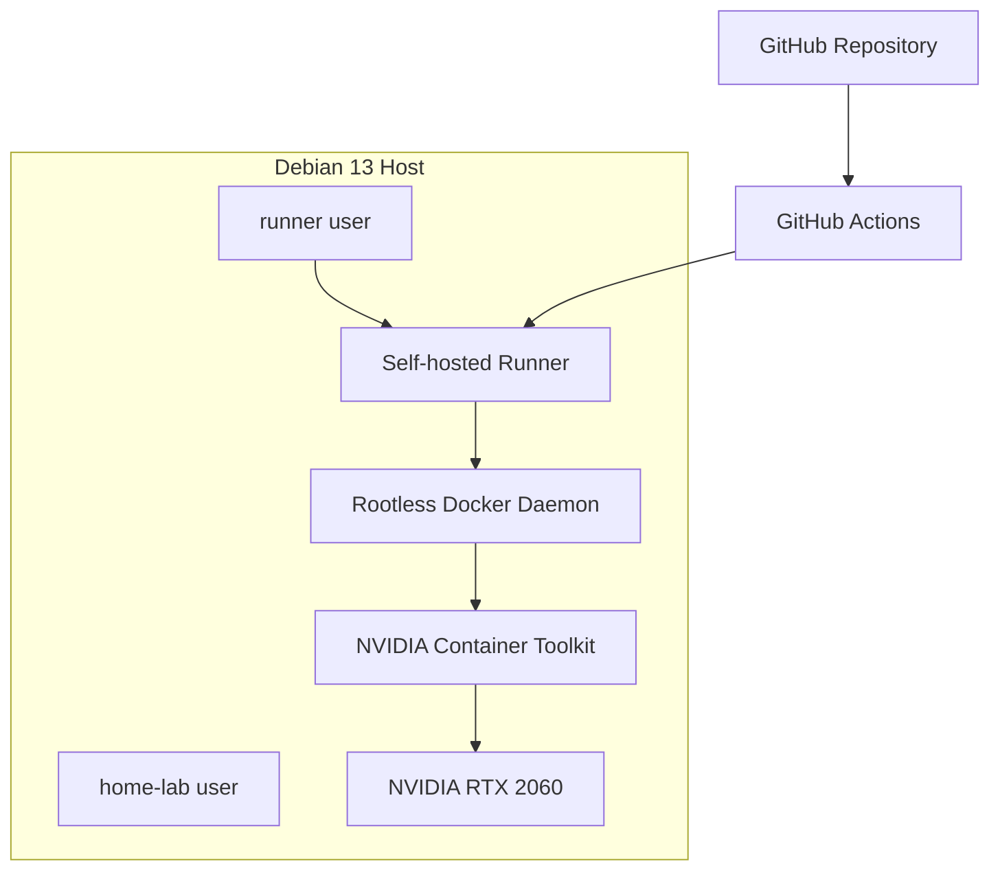

# GitHub Actions Self-hosted Runner and Rootless Docker

This document describes the CI/CD execution environment used by the home lab.

The deployment pipeline uses a GitHub Actions self-hosted runner installed on Debian 13. The runner operates under a dedicated Linux account and uses rootless Docker to build and deploy containers without requiring access to the host's rootful Docker daemon.

The setup also includes NVIDIA Container Toolkit integration, allowing GitHub Actions workflows to execute GPU-enabled containers.

## Architecture



## Hardware and operating system

| Component | Configuration |
|---|---|
| OS | Debian 13 (Trixie) |
| Kernel | Linux 6.12 |
| CPU | Intel Core i5, 10th generation |
| RAM | 16 GB |
| GPU | NVIDIA GeForce RTX 2060 |
| Container runtime | Docker Engine, rootless |
| CI/CD | GitHub Actions |

## 1. Linux user isolation

A separate Linux account is used exclusively for the GitHub Actions runner.

The two main accounts are:

| User | Responsibility |
|---|---|
| `home-lab` | Host administration and system configuration |
| `runner` | CI/CD execution and rootless container deployment |

This separation prevents normal deployment workflows from running under the administrator account.

### Create the runner account

As an administrator:

```bash
sudo adduser runner
```

Use a dedicated account password and do not reuse administrator credentials.

### Restrict home directories

The administrator's home directory should not be accessible to the runner:

```bash
sudo chmod 700 /home/admin
```

Restrict the runner's home directory to its owner:

```bash
sudo chmod 700 /home/runner
```

The runner installation directory is owned by the runner account:

```bash
sudo chown -R runner:runner /opt/github-runner
sudo chmod 750 /opt/github-runner
```

### Remove unnecessary privileges

The runner should not belong to the shared `users` group or the Docker group.

Check its groups:

```bash
id runner
```

Remove unnecessary group memberships if present:

```bash
sudo gpasswd -d runner users
sudo gpasswd -d runner docker
```

Do not run these commands if the user is not a member of the corresponding group.

Verify that the runner has no sudo privileges:

```bash
sudo -l -U runner
```

The intended result is that the runner cannot execute commands through sudo.

**Important:** Docker group membership is effectively root-equivalent on a conventional rootful Docker installation. Rootless Docker is used instead.

## 2. Install the GitHub Actions runner

The runner is installed in:

```text
/opt/github-runner
```

Run the installation and registration process using the dedicated account.

Switch users:

```bash
sudo -iu runner
```

Create the installation directory:

```bash
mkdir -p /opt/github-runner
cd /opt/github-runner
```

Download the current Linux x64 runner package from:

[GitHub Actions runner releases](https://github.com/actions/runner/releases)

Use the current version and checksum provided by GitHub. Avoid copying an old runner version into a new installation.

Extract the downloaded archive:

```bash
tar xzf actions-runner-linux-x64-<version>.tar.gz
```

Configure the runner using the registration token generated in:

```text
GitHub Repository
  → Settings
  → Actions
  → Runners
  → New self-hosted runner
```

Run the configuration command supplied by GitHub. Its general form is:

```bash
./config.sh \
  --url https://github.com/OWNER/REPOSITORY \
  --token REGISTRATION_TOKEN \
  --labels home-lab-runner
```

Replace the placeholders with your repository and temporary registration token.

The registration token is temporary and must not be committed or shared.

### Run as a service

For a persistent runner, install its service using the runner's service script and the dedicated Linux account.

For example, from the runner installation directory:

```bash
sudo ./svc.sh install runner
sudo ./svc.sh start
```

Check the runner service:

```bash
sudo ./svc.sh status
```

The runner should appear as online and idle in the GitHub repository settings.

Consult the current GitHub documentation for runner service installation and updates.

## 3. Configure rootless Docker

Rootless Docker allows the Docker daemon and containers to run under an unprivileged Linux account.

Instead of using the system-wide Docker daemon, the runner uses its own Docker daemon and storage.

### Install required dependencies

As an administrator:

```bash
sudo apt update
sudo apt install uidmap dbus-user-session
```

The `uidmap` package provides utilities such as:

- `newuidmap`
- `newgidmap`

### Configure subordinate UID and GID ranges

Rootless Docker requires subordinate user and group ID ranges.

Check:

```bash
grep runner /etc/subuid
grep runner /etc/subgid
```

The configured ranges in this environment are:

```text
runner:<subuid-start>:65536
```

If they are missing, configure them:

```bash
sudo usermod \
  --add-subuids <subuid-start>-<subuid-end> \
  runner

sudo usermod \
  --add-subgids <subuid-start>-<subuid-end> \
  runner
```

Ensure the ranges do not overlap with another user's assigned ranges.

### Enable lingering

Enable lingering for the runner account:

```bash
sudo loginctl enable-linger runner
```

This allows the user's systemd services to remain active after logout and to start during system boot.

### Install rootless Docker

Switch to the runner account:

```bash
sudo -iu runner
```

Run the rootless setup utility:

```bash
dockerd-rootless-setuptool.sh install
```

The setup configures the Docker daemon under the runner user's account.

The rootless Docker socket is:

```text
/run/user/<runner-uid>/docker.sock
```

The Docker data directory is:

```text
/home/runner/.local/share/docker
```

These paths are specific to this installation and account UID.

### Verify the rootless daemon

Check the user's Docker service:

```bash
systemctl --user status docker
```

Check Docker contexts:

```bash
docker context ls
```

The expected contexts include:

```text
default   unix:///var/run/docker.sock
rootless  unix:///run/user/<runner-uid>/docker.sock
```

Select the rootless context:

```bash
docker context use rootless
```

Verify the daemon:

```bash
docker info
```

The Docker information should show:

- Docker Root Dir under the runner's home directory.
- `rootless` in the security options.
- The rootless Docker server rather than the system-wide daemon.

Test container execution:

```bash
docker run --rm hello-world
```

### Rootless Docker service management

Useful commands:

```bash
systemctl --user status docker
systemctl --user restart docker
systemctl --user stop docker
systemctl --user start docker
```

The daemon runs independently of the administrator's rootful Docker daemon.

Do not assume containers visible through the administrator's Docker context are the same containers managed by the runner.

## 4. Protect deployment environment variables

The deployment `.env` file is stored outside the Git repository.

Location:

```text
/home/runner/secrets/.env
```

Create the directory and configure its permissions:

```bash
mkdir -p /home/runner/secrets
chmod 700 /home/runner/secrets
```

Ensure the file belongs to the runner account:

```bash
sudo chown runner:runner \
  /home/runner/secrets/.env

sudo chmod 600 \
  /home/runner/secrets/.env
```

The `.env` file contains credentials for services such as PostgreSQL, MinIO and Grafana.

It must never be committed to Git.

### Load environment variables during deployment

The deployment workflow copies the protected environment file into the repository workspace:

```yaml
- name: Load deployment environment
  run: |
    cp /home/runner/secrets/.env .env
    chmod 600 .env
```

Docker Compose reads this file during configuration validation and deployment.

Never print its contents in workflow logs.

## 5. NVIDIA GPU passthrough

The host uses an NVIDIA GeForce RTX 2060.

The objective is to make GPU resources available to containers running under the rootless Docker daemon.

### Verify the host GPU

On the Debian host:

```bash
nvidia-smi
```

Verify the NVIDIA kernel driver:

```bash
lspci -nnk -d 10de:
```

The NVIDIA driver should be active.

### Install NVIDIA Container Toolkit

Install NVIDIA Container Toolkit following the official instructions:

[ NVIDIA Container Toolkit installation guide](https://docs.nvidia.com/datacenter/cloud-native/container-toolkit/latest/install-guide.html)

### Configure rootless Docker

As `runner`:

```bash
nvidia-ctk runtime configure \
  --runtime=docker \
  --config="$HOME/.config/docker/daemon.json"
```

The NVIDIA Container Toolkit also requires the appropriate no-cgroups configuration for this rootless setup.

As an administrator, configure:

```bash
sudo nvidia-ctk config \
  --set nvidia-container-cli.no-cgroups \
  --in-place
```

Restart the runner user's Docker daemon:

```bash
sudo -iu runner
systemctl --user restart docker
```

### Verify GPU access

Run:

```bash
docker run --rm --gpus all ubuntu nvidia-smi
```

The container should display the host's NVIDIA GPU information.

This verifies the chain:

```text
GitHub Actions
    ↓
Self-hosted runner
    ↓
Rootless Docker
    ↓
NVIDIA Container Toolkit
    ↓
NVIDIA GPU
```

## 6. GitHub Actions deployment workflow

The deployment workflow automates infrastructure updates.

A simplified example:

```yaml
name: Deploy home-lab infra

on:
  push:
    branches:
      - master
  workflow_dispatch:

concurrency:
  group: mlflow-deployment
  cancel-in-progress: true

jobs:
  deploy:
    runs-on: [self-hosted, linux, x64]
    timeout-minutes: 15

    steps:
      - name: Checkout repository
        uses: actions/checkout@v7

      - name: Load deployment environment
        run: |
          cp /home/runner/secrets/.env .env
          chmod 600 .env

      - name: Validate Docker Compose
        run: docker compose config --quiet

      - name: Build images
        run: docker compose build

      - name: Deploy containers
        run: docker compose up -d --remove-orphans

      - name: Check running containers
        if: always()
        run: docker compose ps
```

This is an illustrative workflow. The production workflow should also include the MLflow health check, deployment logs on failure, and appropriate path filters.

Use a GitHub-hosted runner for public repository validation and reserve the self-hosted runner for trusted deployment workflows.

## 7. Security considerations

A self-hosted runner is a security-sensitive component because workflow code executes on the machine that hosts it.

Important safeguards:

- Use a dedicated Linux account.
- Avoid sudo access for the runner.
- Do not add the runner to the rootful Docker group.
- Use rootless Docker.
- Keep deployment credentials outside the repository.
- Do not print secrets in workflow logs.
- Restrict access to the private deployment repository.
- Do not execute untrusted pull request code on the persistent runner.
- Protect the default branch.
- Review workflow changes before merging.
- Use read-only `GITHUB_TOKEN` permissions where possible.
- Keep the runner and its dependencies updated.

### Public repository warning

Making the portfolio repository public does not mean the self-hosted runner should accept arbitrary workflows from that repository.

A malicious pull request can execute arbitrary workflow code if the runner is exposed to it.

Recommended separation:

| Workflow | Runner |
|---|---|
| Public code validation | GitHub-hosted |
| Linting and static analysis | GitHub-hosted |
| Documentation checks | GitHub-hosted |
| Trusted infrastructure deployment | Private self-hosted runner |

Keep deployment workflows and credentials in a private repository or otherwise enforce an equivalent trusted deployment boundary.

## 8. Troubleshooting

### Docker cannot connect to the daemon

Check the context:

```bash
docker context ls
docker context use rootless
```

Check the user service:

```bash
systemctl --user status docker
```

Check the socket:

```bash
ls -l /run/user/<runner-uid>/docker.sock
```

### Docker works manually but fails in GitHub Actions

Verify that the runner service runs as `runner`.

Check:

```bash
whoami
docker context ls
docker info
```

The workflow should execute under the same account and use the same rootless Docker context.

### GPU is unavailable in containers

Check the host:

```bash
nvidia-smi
```

Check the rootless Docker configuration:

```bash
cat ~/.config/docker/daemon.json
```

Restart Docker after configuration changes:

```bash
systemctl --user restart docker
```

Test again:

```bash
docker run --rm --gpus all ubuntu nvidia-smi
```

### Runner is offline

Check its service status from the runner installation directory:

```bash
sudo ./svc.sh status
```

Inspect the service logs through systemd if necessary.

Also verify that the host has network connectivity to GitHub.

## References

- [GitHub Actions self-hosted runners](https://docs.github.com/en/actions/hosting-your-own-runners)
- [GitHub Actions runner releases](https://github.com/actions/runner/releases)
- [Docker rootless mode](https://docs.docker.com/engine/security/rootless/)
- [NVIDIA Container Toolkit](https://docs.nvidia.com/datacenter/cloud-native/container-toolkit/latest/)
- [systemd user services](https://www.freedesktop.org/software/systemd/man/latest/systemd.html)